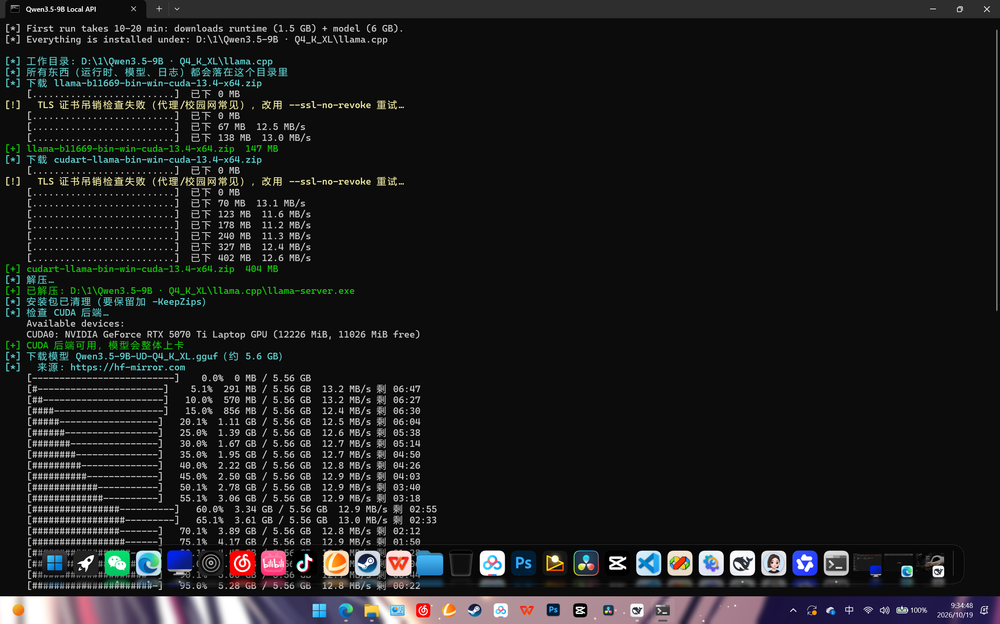
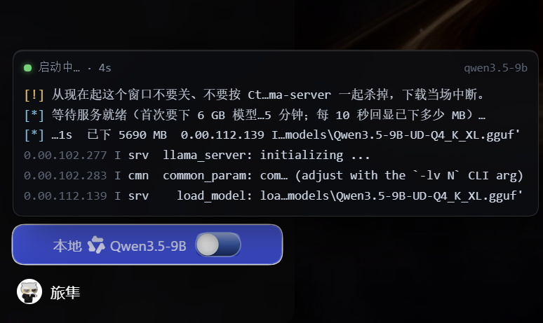

<!-- 放到仓库根目录；图片按仓库内文件名引用 -->
<div align="center">

# Qwen3.5-9B · 128K · 一键部署

**双击 `start-qwen.bat`，六分钟后，你的 12 GB 显卡上跑着 128K 上下文的 Qwen。**

5.6 GB 权重 · 131,072 上下文 · 预填充 **2,813 tok/s** · 解码 55–70 tok/s · 自带 OpenAI 兼容 API

[](#)
[](#)
[](#)
[](#)
[](#)

[一键部署](#-一键部署) · [我的优化](#-我做了什么优化) · [实测数据](#-实测数据) · [API 用法](#-api-用法) · [DSH 插件](#-自带-dsh-插件) · [English](#english)

</div>

---

## 为什么选这套



Qwen 官方给了权重，llama.cpp 给了引擎，但中间隔着一堆事：CUDA 版本要挑、两块 runtime 包要手动解压、显存要算、KV 量化要选、API Key 要配、启动参数有十来个。

这个包里**这些全做完了**，而且每一步都能在屏幕上看见：

- 自带推理引擎（llama.cpp b11669 · CUDA 13.4），**不用装 CUDA Toolkit、不用 Python**
- 预填充 **2,813 tok/s** —— 4.6 万 token 的文档，首字 18.5 秒就能开始吐
- 单行原地刷新的下载进度条，断流会自动换源、断点续传
- 起来就是一个**标准 OpenAI 接口**（`/v1/chat/completions`），能直接喂给任何客户端

---

## 📦 包里有什么

| 文件 | 作用 |
|---|---|
| `start-qwen.bat` | **双击这个**：没安装就先装，装好了就启动 |
| `qwen-deploy.ps1` | 全部逻辑：自检 / 下载 / 校验 / 解压 / 组参数 / 起服务 / 自测 |
| `dsh-local-model-toggle-plugin-0.6.0.zip` | DeepSeek Harness 插件：左下角开关一键启停 |
| `使用说明.md` / `使用说明.html` | 12 章完整说明书 |
| `部署入deepseek harness参数.docx` | 接入 DSH 时要填的字段 |

安装后还会生成 `api-key.txt`（API Key）、`llama.cpp\`（引擎 + 模型 + 日志）、`api-info.txt`（端点速查）。

---

## 🚀 一键部署

```text
① 双击 start-qwen.bat     首次：自动下载引擎（约 550 MB）+ 模型（5.6 GB）
② 等待进度条走完          全程可见，约 6 分钟（带宽 12 MB/s 时）
③ 浏览器自动打开          http://127.0.0.1:8080
```

以后每次就只是双击开、`start-qwen.bat -Stop` 关。

<details>
<summary><b>安装器做了什么（点开）</b></summary>

1. **环境自检**：64 位 / Windows 10+ / `curl` / 显卡能力 / 磁盘空间 / 目录可写 / VC++ 运行库（缺了就自动装）。
2. **引擎**：多源尝试下载 `llama-b11669-bin-win-cuda-13.4-x64.zip` 与 `cudart-llama-...zip`，解压后把散落的 DLL 收拢到 exe 同目录。
3. **验 CUDA**：`llama-server.exe --list-devices`，必须看到 `CUDA0: ... RTX 5070 Ti ...`。
4. **模型**：从 hf-mirror 下 `Qwen3.5-9B-UD-Q4_K_XL.gguf`（5.6 GB），下载前先问远端拿文件大小。
5. **启动**：`--flash-attn on --cache-type-k q8_0 --cache-type-v q8_0 --jinja --metrics`，`-ngl 99` 全量上卡。
6. **自测**：调一次 `/v1/chat/completions`，打印 `predicted_per_second`，并把 Base URL / Key / 模型名写进 `api-info.txt`。

已经装好的部分会自动跳过（幂等），下到一半断了重跑会续传。
</details>

---

## 🔧 我做了什么优化

| # | 坑 | 处理 | 效果 |
|---|---|---|---|
| 1 | 显卡驱动/构建不匹配时**静默回落到 CPU**，慢 30 倍 | 启动前跑 `--list-devices` 强制验证 `CUDA0`，看不到就报错并提示换 `cuda-12.4` 构建 | 不会再“以为自己在上卡，其实在跑 CPU” |
| 2 | GitHub 直连断流、`schannel` 证书吊销检查失败 | 下载带多镜像回退 + `--ssl-no-revoke` + 断点续传 | 一次装完，不用人看着 |
| 3 | 下载过程全黑屏 | 自绘单行进度条（`[####----] 54.0% 3.01 GB / 5.56 GB 13.5 MB/s ETA 03:13`） | 一眼知道“是否正常” |
| 4 | 16 GB 内存下容易被模型钉死 | 显式不设 `--mlock`/`--no-mmap`，让模型走 mmap | 内存不爆，加载更快 |
| 5 | 8 GB 卡照抄 128K 会崩 | 内置显存估算表，`-Ctx` 可传参；文档给出 4 档容量对照 | 8 GB 卡可用 32K，12 GB 卡可 128K |
| 6 | API Key 写死在脚本里，改一次很痛苦 | 优先级 `-ApiKey` > 目录下 `api-key.txt` > 默认值；`-ApiKey ""` 可关校验 | 改钥匙不用碰 ps1 |
| 7 | 服务已经在跑，再双击会起第二个实例抢显存 | 启动前探 `/health`，已在跑就直接打印地址并打开浏览器 | 不会双开 |
| 8 | 模型路径含 `·`、空格、中文，参数被拆开 | 统一用 .NET `ProcessStartInfo` 传参数（不用 `Start-Process -ArgumentList`） | 路径再怪也能起 |
| 9 | 装完留两个 550 MB 的安装包 | 解压成功后自动删 zip（`-KeepZips` 可保留） | 少占 550 MB |
| 10 | 双击 bat 的窗口一关进程就死 | 后台模式用独立进程 + `server.pid`，窗口可关 | 关窗口不停服务 |

> 完整命令、参数表、故障排查见 [`使用说明.html`](使用说明.html)。

---

## 📊 实测数据

同一台机器：RTX 5070 Ti Laptop 12 GB / i7 / 16 GB DDR5-5600 / 驱动 591.91。

**吞吐**

| 指标 | 数值 |
|---|---|
| 预填充 | **2,813 tok/s** |
| 解码（短答） | 55–70 tok/s |
| 上下文 | 131,072 token（4 个并发槽位） |
| 显存占用 | 约 9.4 GB（131K 配置空载 10.3 GB 中含上下文缓冲） |

**首字延迟**（`enable_thinking:false`，流式）

| 提示 | 首字 | 说明 |
|---|---|---|
| 4 token | **110 ms** | 基本是纯网络+调度开销 |
| 1.1K token | 605 ms | 预填充 2,631 tok/s |
| 3.8K token | 1,303 ms | 2,978 tok/s |
| 15K token | ~2,000 ms | 前缀缓存命中时更短 |
| 30K token | 6,944 ms | 2,214 tok/s，长文开始变慢 |

经验值：**每 1000 token 输入，首字约 +0.35 秒**；超长提示按 0.5 秒/1000 token 估更接近实际。



---

## 🔌 API 用法

服务起来后即是一个 OpenAI 兼容端点：

```text
Base URL : http://127.0.0.1:8080/v1
API Key  : sk-87ee67e0e1b430f88db29013fe07d7f9de05830ba56647ce   （见 api-key.txt）
模型名   : qwen3.5-9b
端点     : /v1/models  /v1/chat/completions  /v1/completions  /health  /props  /metrics
```

```python
from openai import OpenAI

client = OpenAI(base_url="http://127.0.0.1:8080/v1",
                api_key="sk-87ee67e0e1b430f88db29013fe07d7f9de05830ba56647ce")

r = client.chat.completions.create(
    model="qwen3.5-9b",
    messages=[{"role": "user", "content": "用三句话解释什么是 KV cache"}],
    temperature=0.3,
    max_tokens=1024,
)
print(r.choices[0].message.content)
```

<details>
<summary><b>两个容易踩的点</b></summary>

- **思考模式**：Qwen3.5 默认先写 `reasoning_content`（英文推理），正文在 `content` 里。`max_tokens` 给小了会得到空正文。想直接出正文：`"chat_template_kwargs": {"enable_thinking": false}`。
- **`/health` 免 key，其余端点都要**：`/v1/models`、`/props`、`/metrics` 不带 `Authorization: Bearer <key>` 会 401。
</details>

---

## 🎛 自带 DSH 插件

`dsh-local-model-toggle-plugin-0.6.0.zip`：

- 左侧栏底部一个胶囊开关，左键启停、右键菜单
- 自动识别 DSH 里所有本地模型（回环地址），右键切换，**不会串台**
- 每个模型独立记录部署夹与上下文长度
- 闲置自动关停，把显存让给游戏
- 找不到部署夹时红点 + 右键选目录

接入 DSH 的字段（详见 `部署入deepseek harness参数.docx`）：Provider ID `local-qwen`、端点 `http://127.0.0.1:8080/v1`、协议 `OpenAI Chat Completions`、密钥同上、模型 `qwen3.5-9b`、上下文 `131072`。

---

## 🆚 和 Bonsai 27B 怎么选

| | Qwen3.5-9B（本仓库） | Bonsai 27B（[姊妹仓库](https://github.com/lvsun080403/Bonsai-27B-72K-DSH-)） |
|---|---|---|
| 权重 | 5.56 GiB（Q4_K_XL） | 8.87 GiB（三进制） |
| 参数 | 8.95B | 27B |
| 上下文 | **131,072** | 73,728 |
| 预填充 | **2,813 tok/s** | 564–724 tok/s |
| 解码 | 55–70 tok/s | 57–66 tok/s |
| 显存 | 9.4 GB | 10.5 GB |
| 长文首字 | **快 3.4 倍**（46K 提示：18.5 s vs 63.5 s） | 慢 |
| 拿来干嘛 | 日常问答、写代码、当 agent 的脑 | 一次读完一本书、离线兜底 |

一句话：**要首字快就用 9B，要一次吞下整本书就用 27B**。

---

## ⚠️ 已知限制

1. 默认上下文 131,072，这是 12 GB 卡上的舒适值；再往上要牺牲其他程序的显存（每 +32K 约 +544 MB）。
2. 显存不够时 `--n-gpu-layers` 会自动部分卸载到 CPU，速度掉到个位数 —— 包里有 `-Ctx` 可用来降配置。
3. 单模型单实例；要同时跑多个本地模型，用配套的 DSH 插件切换，别同时开。
4. 模型是 Q4_K_XL，长文里的事实性幻觉依旧存在；重要事实请二次核对。

---

## 🙏 来源

- 模型：**Qwen3.5-9B**（阿里，Apache-2.0），量化版 `unsloth/Qwen3.5-9B-GGUF` · `UD-Q4_K_XL`
- 引擎：**llama.cpp** `b11669`（CUDA 13.4 构建）+ cudart 运行时
- 下载镜像：`hf-mirror.com` / GitHub 加速前缀
- 部署脚本、参数调优、DSH 插件：本仓库

> 参数是一档一档在真机上试出来的（显存、上下文、KV 类型、线程数）。如果你在 8 GB / 16 GB 卡上跑，欢迎开 issue 贴你的 `-Ctx` 与显存曲线。

---

<a id="english"></a>

# 🇬🇧 English

<div align="center">
<b>Double-click <code>start-qwen.bat</code>. Six minutes later, a 128K-context Qwen runs on your 12 GB GPU.</b>
</div>

## What this is

A one-click Windows bundle for **Qwen3.5-9B (UD-Q4_K_XL)** on llama.cpp. No CUDA Toolkit, no Python, no compilation — the installer fetches the engine (~550 MB) and the weights (5.6 GB), verifies CUDA is actually active, and drops you into a standard OpenAI-compatible endpoint.

| | |
|---|---|
| Weights | 5.56 GiB · 8.95B params · `UD-Q4_K_XL` |
| Context | **131,072 tokens** · 4 concurrent slots |
| Prefill | **2,813 tok/s** |
| Decode | 55–70 tok/s |
| VRAM | ~9.4 GB (12 GB card) |
| API | `http://127.0.0.1:8080/v1` · model `qwen3.5-9b` |

## 🚀 Three steps

```text
1. double-click start-qwen.bat     first run downloads engine + model, then starts
2. watch the single-line progress bar
3. browser opens http://127.0.0.1:8080
```

Re-running is idempotent; interrupted downloads resume.

## 🔧 What I changed

| # | Problem | Fix |
|---|---|---|
| 1 | Bad driver/build silently falls back to **CPU** (30× slower) | Pre-flight `--list-devices`, abort unless `CUDA0` is present |
| 2 | GitHub stalls; `schannel` revocation check fails | Multi-mirror failover + `--ssl-no-revoke` + resume |
| 3 | No download visibility | Single-line inline progress bar |
| 4 | 16 GB RAM gets pinned by the model | Deliberately no `--mlock` / `--no-mmap` |
| 5 | Blindly using 128K on an 8 GB card crashes | `-Ctx` parameter + a VRAM table in the docs |
| 6 | API key hard-coded in the script | Precedence: `-ApiKey` > `api-key.txt` > default; `-ApiKey ""` disables auth |
| 7 | Double-clicking again starts a second instance | `/health` probe short-circuits; prints the URL instead |
| 8 | Paths with spaces / CJK broke the command line | .NET `ProcessStartInfo` instead of `Start-Process -ArgumentList` |
| 9 | 550 MB of installer zips left behind | Auto-deleted after extraction (`-KeepZips` to keep) |
| 10 | Closing the console killed the server | Background mode with `server.pid` |

## 📊 Measured

RTX 5070 Ti Laptop (12 GB) · 16 GB DDR5-5600:

| Metric | Value |
|---|---|
| Prefill | 2,813 tok/s |
| Decode | 55–70 tok/s |
| TTFT @ 1.1K | 605 ms |
| TTFT @ 3.8K | 1,303 ms |
| TTFT @ 30K | 6,944 ms |

Rule of thumb: **+0.35 s of TTFT per 1,000 input tokens**.

## ⚠️ Limits

- 131,072 context is the comfortable value on 12 GB; each extra 32K costs ~544 MB of VRAM.
- One model, one instance. To juggle several local models, use the bundled DSH plugin.
- Q4_K_XL still hallucinates on factual questions — verify anything that matters.

## 🙏 Credits

Model **Qwen3.5-9B** by Alibaba (Apache-2.0), quantized by **unsloth**; engine **llama.cpp b11669** (CUDA 13.4); mirrors via `hf-mirror.com`. Packaging, tuning and the DSH plugin by this repo.

<div align="center"><sub>If this saved you an afternoon, a ⭐ helps other people find it.</sub></div>
